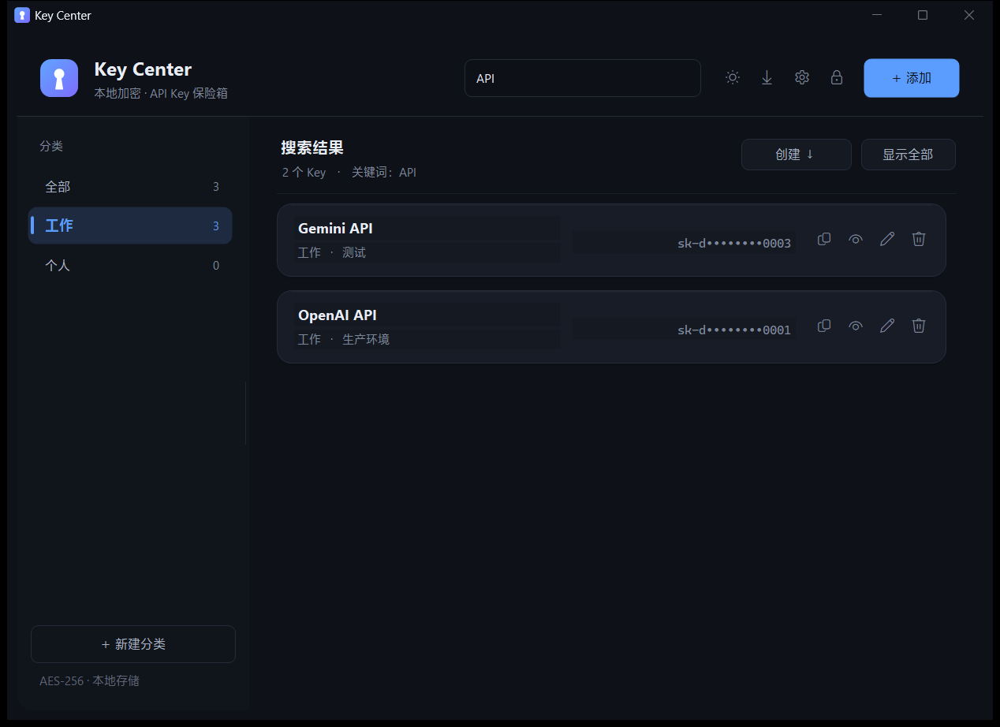

<div align="center">


# Key Center

**A focused, local-first API key vault for Windows**  
**一个专注、清爽的本地 API Key 保险箱**

[](LICENSE)
[](https://github.com/verneuil/KeyCenter/releases/latest)
[](#requirements)
[](#requirements)

[中文](README.md) · **English** · [Changelog](CHANGELOG.md)

</div>

---

Key Center does one thing: it gathers the **API keys** scattered across your apps, projects and terminals into one clean, encrypted local vault.

No account, no cloud sync, no installer, no background service. One portable executable, one encrypted local file, one master password. It does not try to be a full password manager — it does not store URLs or usernames, and it does not generate passwords. It just does **name + multiple keys + notes + categories** exceptionally well.

> **A small, local-first vault for API keys.** No account, no cloud, no installer, no background service. One portable executable, one encrypted local file, one master password.

## Contents

- [Why Key Center](#why-key-center)
- [Features](#features)
- [Screenshots](#screenshots)
- [Quick start](#quick-start)
- [Keyboard shortcuts](#keyboard-shortcuts)
- [Data & security](#data--security)
- [Portable layout](#portable-layout)
- [Build from source](#build-from-source)
- [FAQ](#faq)
- [License](#license)

## Why Key Center

- **Local-first** — everything stays on your machine, encrypted at rest; the app makes no network requests.
- **Truly portable** — a single `KeyCenter.exe`; no installation, no registry writes, no user-profile clutter.
- **Multi-key entries** — keep several keys for the same service or project in one entry and switch the default key anytime.
- **Focused and complete** — categories, search, sorting, copy, reveal/hide, plaintext export, auto-lock and window memory, all included.
- **Native feel** — a hand-crafted WinForms UI with dark/light/system themes, Acrylic backdrop, high-DPI and multi-monitor support.
- **Buildable** — plain C# / .NET Framework source with no NuGet and no third-party runtime dependencies.

## Features

### One entry, many keys

- Each entry can hold any number of keys — ideal for multiple projects, environments or accounts of the same provider.
- The list shows only the **default key** (masked), and the copy button copies it.
- Every key can have its own label; unlabeled keys are named `Key 1`, `Key 2`, …
- Clicking a card's title, value or empty area opens the **Key details** dialog, where you can:
  - view every key in the entry;
  - copy any key with one click;
  - reveal / hide;
  - click ☆ to change the default key;
  - jump straight to editing.

### Categories, search and sorting

- Create, rename and delete categories in the left sidebar; drag its right edge to resize the sidebar.
- Settings → Categories: use the **↑ / ↓** buttons on each row to reorder categories; changes apply and save as soon as the dialog closes.
- Search filters by **name, category and note**.
- Sort by created time (new/old), updated time (new/old), or name A→Z / Z→A.

### Copy and reveal

- Every key row has **copy / reveal / edit / delete** actions.
- “Show all / Hide all” toggles the whole current list at once.
- Clipboard content written by Key Center is cleared on lock or exit when it has not been replaced by something else.

### Plaintext export

- Use the download icon or `Ctrl + E` to export all keys into a category-grouped `.txt` file.
- You must **re-enter the master password** before exporting.
- The export marks each entry's default key, making migration or offline backup straightforward.
- ⚠️ The exported file is plaintext. Do not upload it or share it, and delete it when you are done.

### Themes and appearance

- **Dark / Light / Follow system** themes, switchable live in Settings.
- The sun / moon icon in the header toggles dark and light instantly (`Ctrl + T`); “Follow system” tracks the Windows app theme.
- On Windows 11, an **Acrylic backdrop** and rounded window corners complement the glass-style cards, panels and thin scrollbars.
- Full **high-DPI / multi-monitor** support: move the window between displays with different scaling and the UI re-layouts for the current DPI.

### Window memory and auto-lock

- Remembers the main window size and position, sidebar width, sort order and theme preference.
- Configurable auto-lock after 0 / 1 / 5 / 15 / 30 minutes of inactivity.
- Settings → Appearance → **Restore default window size** resets the window to 1000×700 and centers it on the primary display.
- Only one instance can open the same data file at a time.

## Screenshots

| Light theme | Dark theme |
|:---:|:---:|
|  |  |

| Settings | Search |
|:---:|:---:|
|  |  |

## Quick start

### Requirements

- Windows 10 / Windows 11 (64-bit)
- The built-in **.NET Framework 4.x** (included with Windows 10 / 11; nothing to install)

### Download and run

1. Download `KeyCenter.exe` (or the portable archive) from [Releases](https://github.com/verneuil/KeyCenter/releases/latest).
2. Put `KeyCenter.exe` in any folder and double-click it.
3. On first launch, set a **master password** (at least 6 characters).
4. Enter that password on subsequent launches to see all your keys.

No installation, no registry writes. To uninstall, simply delete the executable and its data files.

## Keyboard shortcuts

| Shortcut | Action |
| --- | --- |
| `Ctrl + N` | Add a key |
| `Ctrl + F` | Focus search |
| `Ctrl + L` | Lock |
| `Ctrl + T` | Toggle dark / light |
| `Ctrl + E` | Export all keys (master password required) |
| `Ctrl + S` | Retry a failed save |
| `Enter` | Submit the password on the login / setup screen |

## Data & security

- **Encryption**: AES-256-CBC + PBKDF2-HMAC-SHA256 (210,000 iterations) + HMAC-SHA256 integrity check.
- **The master password is never stored**; it is used only to derive the key. If you forget it, it cannot be recovered.
- **Fully offline**: the app makes no network requests — no uploads, no telemetry, no update checks.
- **Safe writes**: data is written to a temporary file, flushed, then committed; the previous version is kept as an encrypted `.bak` backup.
- **Auto-lock**: after the configured idle time the vault locks; locking or exiting clears the session key and clipboard content written by Key Center.
- **Single-instance protection**: only one instance can open the same data file, preventing concurrent writes.

> Key Center is not a replacement for a full password manager. Keep your master password safe and back up the encrypted data file regularly.

For security reports, see [SECURITY.md](SECURITY.md).

## Portable layout

```
KeyCenter.exe        Main application (single portable file)
keycenter.dat        Encrypted local data file (created after setting a password)
keycenter.dat.bak    Encrypted backup of the last successful save
keycenter.cfg        UI preferences (theme, window position, sidebar width, sort order); plain text, no secrets
```

- To move to another PC or folder, copy `KeyCenter.exe` and `keycenter.dat` together; `keycenter.cfg` is optional.
- Deleting `keycenter.dat` erases all data — use with care.
- All UI preferences live next to the executable; nothing is written to the registry or user-profile directories.

## Build from source

You only need the .NET Framework 4.x compiler that ships with Windows 10 / 11 — no Visual Studio or .NET SDK required.

```powershell
powershell -ExecutionPolicy Bypass -File .\build.ps1
```

The build produces `KeyCenter.exe` and `keycenter.ico` in the project root.

### Stack

- Pure C# WinForms with hand-written layout and custom-drawn controls
- Compatible with C# 5 / .NET Framework 4.x
- No NuGet, no third-party runtime dependencies
- Single-file output, no installer

### Self-test

```powershell
.\KeyCenter.exe --selftest selftest.log
```

`SELFTEST OK` means the encryption, serialization and file I/O self-test passed.

## FAQ

**I forgot my master password. Can it be recovered?**  
No. Delete `keycenter.dat` and start over.

**Does it upload anything?**  
No. The application contains no network code; all data stays encrypted on your machine.

**How do I move to a new PC?**  
Copy `KeyCenter.exe` and `keycenter.dat` together. Include `keycenter.cfg` if you also want to keep window and theme preferences.

**Can I run it from a USB drive?**  
Yes. It is fully portable; the data file lives next to the executable.

**Why does antivirus occasionally flag it?**  
This is common for unsigned single-file executables. The source is fully public, and you can rebuild it yourself with `build.ps1`.

## License

[MIT License](LICENSE) © 2026 verneuil

---

<div align="center">
  <sub>Built with plain C# and WinForms. No accounts, no cloud, no tracking.</sub>
</div>
