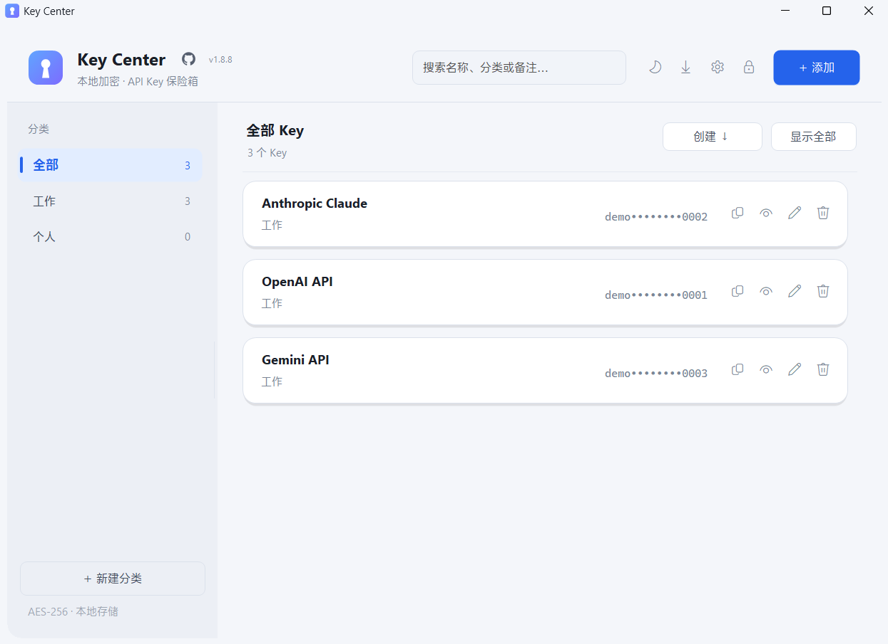
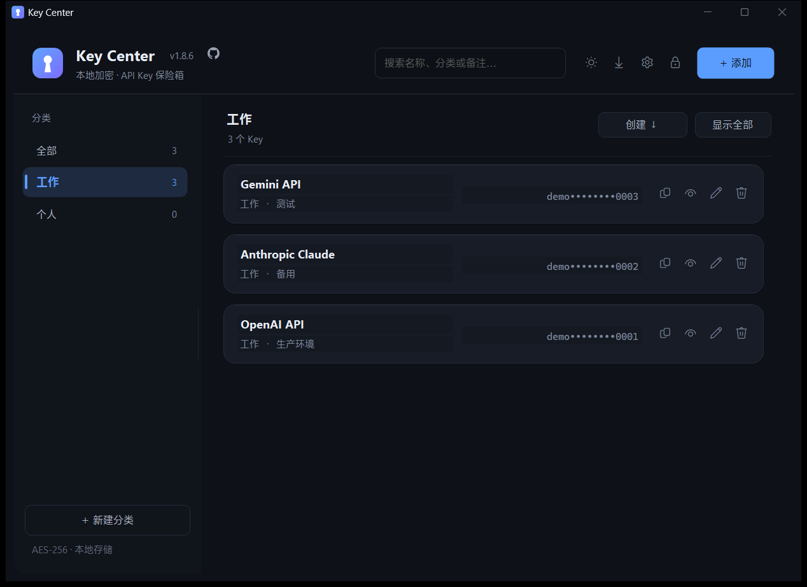
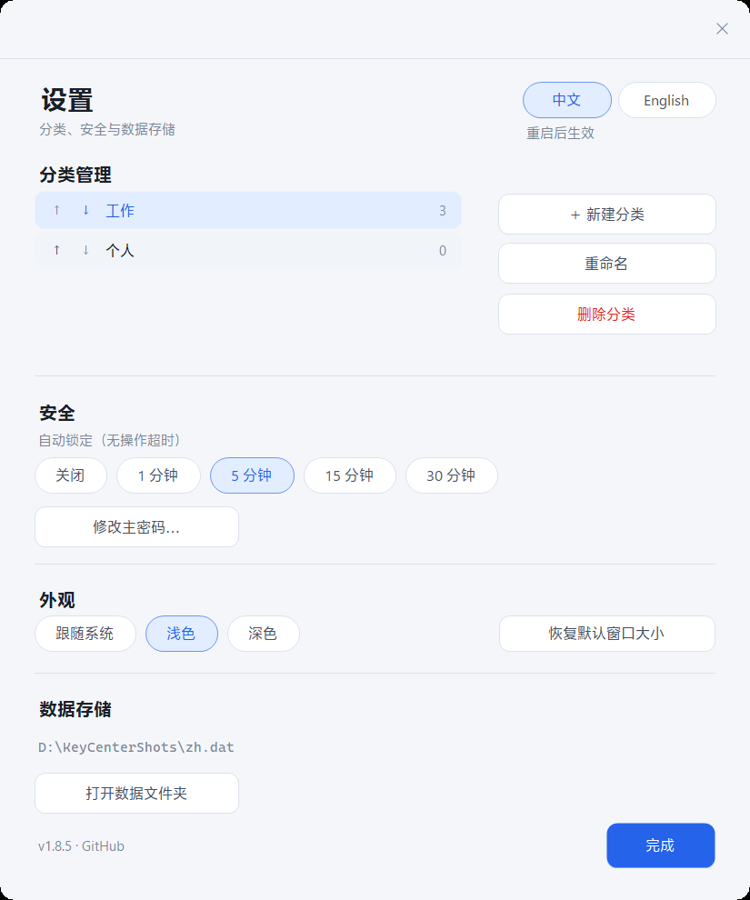
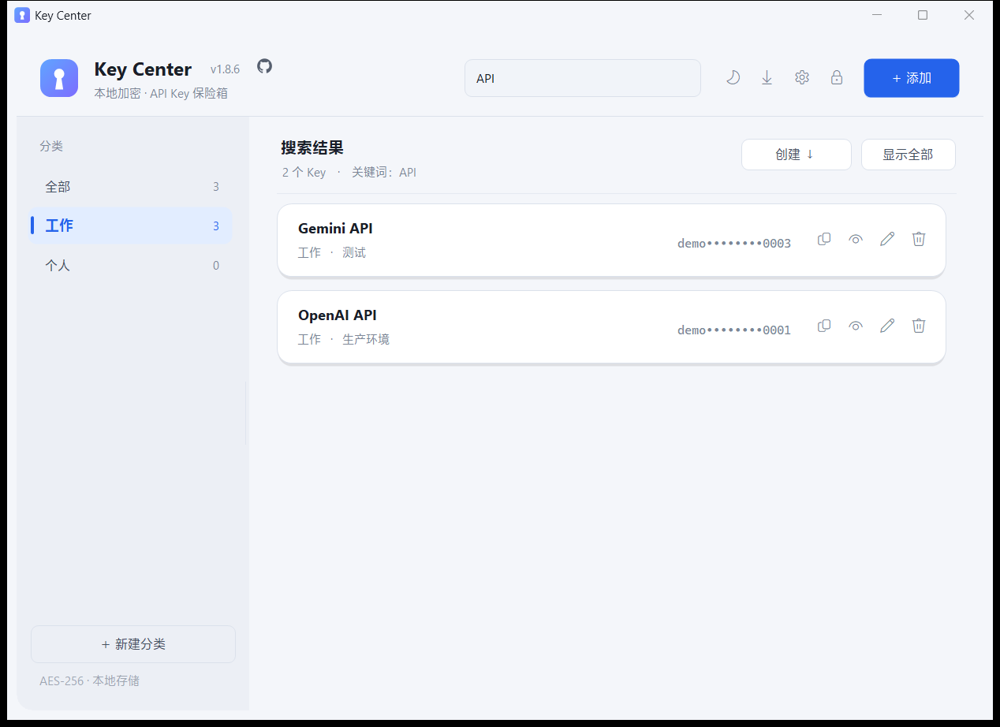
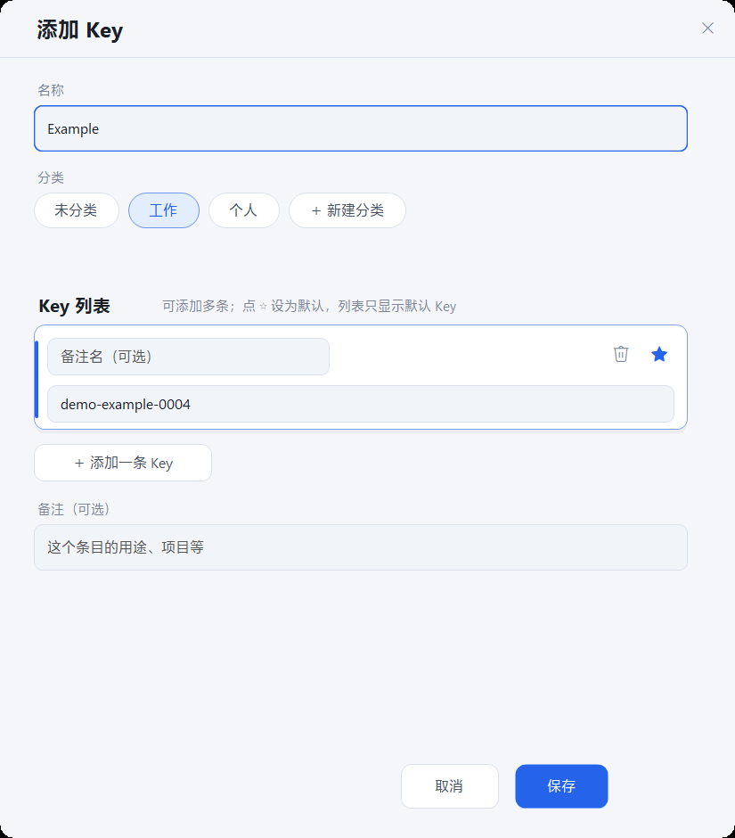
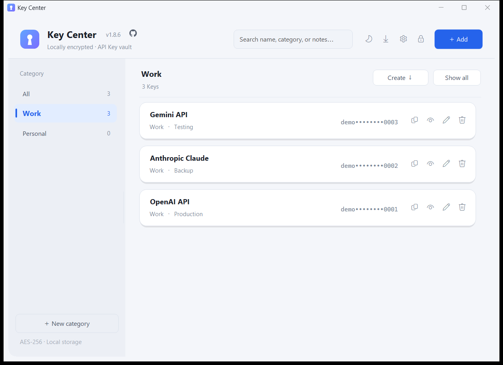

<div align="center">


# Key Center

**一个专注、清爽的本地 API Key 保险箱**  
**A focused, local-first API key vault for Windows**

[](README.md) [](README.en.md)

[](LICENSE)
[](https://github.com/verneuil/KeyCenter/releases/latest)
[](#运行要求)
[](#运行要求)

[更新日志](CHANGELOG.md)

</div>

---

Key Center 只做一件事：把你散落在各个软件、项目和终端里的 **API Key** 收进一个干净、加密的本地保险箱。

没有账号、没有云同步、没有安装器，也没有后台服务。一个单文件程序，一份本地加密数据，打开时输入主密码即可查看、搜索和复制。它不试图成为完整的密码管理器——不记录网址、用户名，也不生成密码；它只负责把 **名称 + 多条 Key + 备注 + 分类** 这件事做好。

> **A small, local-first vault for API keys.** No account, no cloud, no installer, no background service. One portable executable, one encrypted local file, one master password.

## 目录

- [为什么选择 Key Center](#为什么选择-key-center)
- [功能](#功能)
- [截图](#截图)
- [快速开始](#快速开始)
- [快捷键](#快捷键)
- [数据与安全](#数据与安全)
- [便携与文件结构](#便携与文件结构)
- [从源码构建](#从源码构建)
- [常见问题](#常见问题)
- [许可](#许可)

## 为什么选择 Key Center

- **本地优先**：所有数据只保存在本机，加密后落盘；程序自身不发起网络请求，界面中的 GitHub 链接由系统浏览器打开。
- **绿色便携**：单个 `KeyCenter.exe`，不需要安装、不写注册表、不产生用户目录垃圾。
- **真正的多 Key 条目**：同一服务、同一项目的多个 Key 可以放在一个条目里，随时切换默认 Key。
- **专注而完整**：分类、搜索、排序、复制、显示/隐藏、明文导出、自动锁定、窗口记忆，一样不少。
- **原生体验**：纯 WinForms 手写界面，支持深色/浅色/跟随系统、Acrylic 玻璃背景、高 DPI 与多显示器。
- **可自行编译**：纯 C# / .NET Framework 源码，无 NuGet、无第三方运行时依赖。

## 功能

### 一个条目，多条 Key

- 每个条目可以保存任意多条 Key，适合同一服务商的多个项目、多个环境或多个账号。
- 列表中只显示你指定的 **默认 Key**（打码显示），复制按钮复制的也是它。
- 每条 Key 可以自定义备注名；不填则自动命名为 `Key 1`、`Key 2`……
- 点击卡片的名称、数值或空白处，都会打开 **Key 详情** 窗口：
  - 查看该条目下的全部 Key；
  - 一键复制任意一条；
  - 显示 / 隐藏；
  - 点 ☆ 切换默认 Key；
  - 直接进入编辑。

### 分类、搜索与排序

- 左侧分类栏支持新建、重命名、删除分类；拖动右侧边缘可调整侧边栏宽度。
- 设置 → 分类管理：通过每行左侧的 **↑ / ↓** 按钮调整分类顺序，关闭设置后立即生效。
- 搜索支持按 **名称、分类、备注** 过滤。
- 排序支持：创建时间（新/旧）、编辑时间（新/旧）、名称 A→Z / Z→A。

### 复制与显示

- 每条 Key 右侧都有 **复制 / 显示 / 编辑 / 删除** 操作。
- 「显示全部 / 全部隐藏」可批量控制当前列表的显示状态。
- 复制后，本程序写入的剪贴板内容会在锁定或退出时自动清理（若没有被其他内容覆盖）。

### 双语界面

- 支持 **简体中文 / English** 两种界面语言，覆盖主界面、解锁与创建密码、设置、全部弹窗、提示、错误信息、空状态和导出内容；
- 在 设置 → 右上角「中文 / English」切换：点击目标语言后立即用目标语言弹窗确认；确认后安全保存当前设置并重启，取消则撤销语言选择并返回设置；
- 界面全部使用同一套文案字典，后续功能可以继续补充双语条目。

### 版本与项目入口

- 主界面软件名称右侧显示当前版本号（例如 `v1.8.8`）和 GitHub 官方图标；
- 点击版本号打开 [Releases](https://github.com/verneuil/KeyCenter/releases) 页面，查看最新版本和发布记录；
- 点击 GitHub 图标打开仓库首页，方便查看源码、反馈问题和下载。

### 窗口与弹窗质感

- 所有弹窗统一使用顶部标题栏，标题只出现一次，不再显示系统原生重复小标题；
- 弹窗使用完整的四周阴影和关闭按钮，支持拖动、Esc 关闭与基础开关动效；
- 设置、分类、添加/编辑 Key、Key 详情、修改主密码、导出验证、确认框和信息框全部使用同一套规范。

### 明文导出

- 右上角下载图标或 `Ctrl + E` 可将全部 Key 导出为按分类整理的 `txt` 文件。
- 导出前必须 **再次输入主密码** 验证。
- 导出文件会标注每条 Key 的默认状态，方便迁移或做离线备份。
- ⚠️ 明文文件包含敏感信息，请勿上传网盘或发送给他人，使用后建议及时删除。

### 主题与外观

- **深色 / 浅色 / 跟随系统** 三种外观，设置中实时切换。
- 右上角太阳 / 月亮图标可在深色、浅色之间快速切换（`Ctrl + T`）；选择「跟随系统」后会随 Windows 应用主题自动变化。
- Windows 11 下启用 **Acrylic 玻璃背景** 与窗口圆角，配合玻璃质感的卡片、面板和细滚动条。
- 完整支持 **高 DPI / 多显示器**：在不同缩放比例的显示器之间拖动窗口时，界面会按当前显示器 DPI 重新排版。

### 窗口、记忆与自动锁定

- 自动记住主窗口的大小和位置、侧边栏宽度、排序方式和主题偏好。
- 可配置无操作自动锁定：关闭 / 1 / 5 / 15 / 30 分钟。
- 设置 → 外观 → **恢复默认窗口大小**：窗口恢复为 1000×700 并居中到主屏。
- 同一时间只允许一个实例打开同一数据文件。

## 截图

| 浅色主题 | 深色主题 |
|:---:|:---:|
|  |  |

| 设置（含语言切换） | 搜索 |
|:---:|:---:|
|  |  |

| 添加 Key | English UI |
|:---:|:---:|
|  |  |

## 快速开始

### 运行要求

- Windows 10 / Windows 11（64 位）
- 系统自带的 **.NET Framework 4.x**（Windows 10 / 11 默认包含，无需额外安装）

### 下载与运行

1. 从 [Releases](https://github.com/verneuil/KeyCenter/releases/latest) 下载 `KeyCenter.exe`（或便携压缩包）。
2. 将 `KeyCenter.exe` 放到任意文件夹，双击运行。
3. 第一次打开时设置 **主密码**（至少 6 位）。
4. 之后每次打开输入主密码即可看到全部 Key。
5. 首次启动默认中文；设置右上角可切换 **English**，按目标语言确认并重启后生效。

无需安装，不写注册表。卸载时直接删除程序和数据文件即可。

## 快捷键

| 按键 | 功能 |
| --- | --- |
| `Ctrl + N` | 添加 Key |
| `Ctrl + F` | 聚焦搜索框 |
| `Ctrl + L` | 锁定 |
| `Ctrl + T` | 切换深色 / 浅色 |
| `Ctrl + E` | 导出所有 Key（需验证主密码） |
| `Ctrl + S` | 保存失败后手动重试保存 |
| `Enter` | 登录 / 解锁界面提交密码 |

## 数据与安全

- **加密算法**：AES-256-CBC + PBKDF2-HMAC-SHA256（210,000 次迭代）+ HMAC-SHA256 完整性校验。
- **主密码不保存**：主密码只用于派生密钥，不会以任何形式保存；忘记后无法找回。
- **完全离线**：程序自身不发起网络请求，不上传、不遥测、不检查更新；点击界面中的 GitHub 链接会交给系统浏览器处理。
- **安全写入**：先写临时文件并落盘，再替换正式文件；旧版本保留为加密的 `.bak` 备份。
- **自动锁定**：无操作达到设定时间后自动锁定；锁定或退出时清理会话密钥和本程序写入的剪贴板内容。
- **单实例保护**：同一数据文件同时只允许一个实例打开，避免并发写入。

> Key Center 不能替代完整的密码管理器。请自行保管好主密码，并定期备份加密数据文件。

安全问题的报告方式见 [SECURITY.md](SECURITY.md)。

## 便携与文件结构

```
KeyCenter.exe        主程序（单文件、绿色运行）
keycenter.dat        加密后的本地数据文件（首次创建密码后生成）
keycenter.dat.bak    上一次成功保存的加密备份
keycenter.cfg        界面偏好（主题 / 语言 / 窗口位置 / 侧边栏宽度 / 排序），纯文本，不含密钥
```

- 换电脑或移动文件夹：把 `KeyCenter.exe` 与 `keycenter.dat` 一起复制即可；`.cfg` 可选。
- 删除 `keycenter.dat` 会清空全部数据，请谨慎操作。
- 所有界面偏好都保存在程序同目录，不写入注册表或用户配置目录。

## 从源码构建

需要 Windows 10 / 11 自带的 .NET Framework 4.x 编译器，无需 Visual Studio 或 .NET SDK。

```powershell
powershell -ExecutionPolicy Bypass -File .\build.ps1
```

构建完成后会在项目根目录生成 `KeyCenter.exe` 和 `keycenter.ico`。

### 技术栈

- 纯 C# WinForms，手写布局与自绘控件
- 兼容 C# 5 / .NET Framework 4.x
- 无 NuGet、无第三方运行时依赖
- 单文件发布，无安装器

### 自检

```powershell
.\KeyCenter.exe --selftest selftest.log
```

输出 `SELFTEST OK` 表示加密、序列化与文件读写自检通过。

### 回归检查

加密、保存、锁定、导出、主题、DPI 与双语覆盖的自动门禁：

```powershell
powershell -ExecutionPolicy Bypass -File .\tests\regression.ps1
```

通过时输出 `SELFTEST OK`、`LOCALIZATION/METADATA AUDIT OK` 与 `REGRESSION PASSED`。手工 UI 清单见 [REGRESSION.md](REGRESSION.md)。界面/弹窗自动测试统一使用 [tests/ui/README.md](tests/ui/README.md) 中的工具；测试进程会在 `finally` 中强制关闭。

## 常见问题

**忘记主密码怎么办？**  
无法找回。只能删除 `keycenter.dat` 重新开始。

**数据会上传吗？**  
不会。程序自身不发起网络请求，所有数据只在本机加密保存；点击 GitHub 链接由系统浏览器打开。

**换电脑怎么迁移？**  
把 `KeyCenter.exe` 和 `keycenter.dat` 一起复制到新电脑即可；如果希望保留窗口、主题和语言设置，再带上 `keycenter.cfg`。

**可以放 U 盘里用吗？**  
可以。程序是绿色版，数据文件会保存在 exe 同目录。

**为什么杀毒软件偶尔提示？**  
这是未签名的单文件程序常见现象。源码完全公开，可自行使用 `build.ps1` 重新编译。

## 许可

[MIT License](LICENSE) © 2026 verneuil

---

<div align="center">
  <sub>Built with plain C# and WinForms. No accounts, no cloud, no tracking.</sub>
</div>

